# Consumer topologies

How thin-caller workflows in *consumer* repos wire up the reusable workflows and
composite actions in this repo. Every diagram below is drawn from a real consumer
so you can copy the shape that matches your repo.

The `test-*` repos (under `wshno/`) are the minimal examples, one scenario each. The
advanced consumers (`clutterstock`, `wsh-rtl-sdr`, `proxmox`) pin a v2 release by commit
SHA, as every caller should. For how an app's workflows link up across PR, main, the
nightly run and release, see [workflow-map.md](workflow-map.md).

## How to read these

A *thin caller* is a workflow in your repo that mostly just sets `uses:`, `with:`,
`needs:`, and an `if:` gate. The heavy lifting (build, scan, push, sign, attest,
publish) lives in this repo. There are two ways your repo touches this library, and
the distinction matters for OIDC identity:

- **Reusable workflow** (`uses:` at the **job** level, `.github/workflows/x.yml@v2`)
  — owns the job it defines. Its OIDC token carries **this repo's**
  `job_workflow_ref`, so anything it signs is signed under the shared
  `hwinther/reusable-workflows` identity.
- **Composite action** (`uses:` at the **step** level, `.github/actions/x@v2`) —
  runs **inline in your job**, so its OIDC token carries **your** repo's ref. This
  is why `sign-image` is a composite: it lets signatures bind to the consumer's
  identity. See **Consumer-side signing** below.

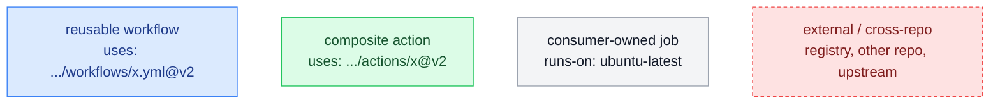

Solid arrows are `needs:` ordering (and what flows along them); dotted arrows are
data/artifacts that travel between jobs without being the primary dependency.

## The layering

Consumers almost never touch the internal (`_`-prefixed) building blocks directly —
they call a reusable workflow or a public composite, which fans out to the internals.

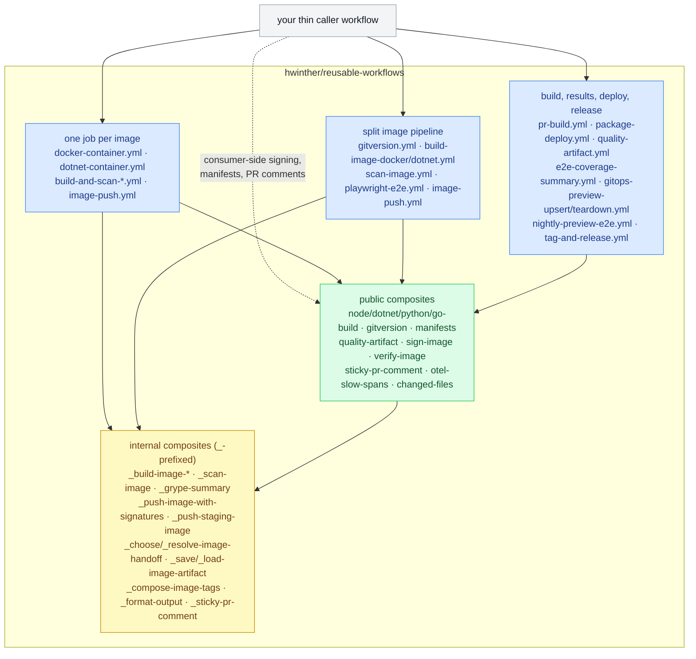

The two image shapes: **one job per image** builds, scans and pushes in a single reusable
job (release builds, utility images). The **split pipeline** builds each image once and
hands it on by reference, so scan and e2e run in parallel on the same bytes before the
push (app PRs and main; see [workflow-map.md](workflow-map.md)).

---

# Minimal examples — `test-*`

Each `test-*` repo isolates one scenario. Start here; the advanced repos are just
several of these composed together.

## Single-image container publish — `test-ghcr/web-container.yml`

Push to `main` (or manual dispatch) → one reusable job builds, scans, pushes, signs,
and attests. This is the smallest useful shape. `api-container.yml` is identical but
calls `dotnet-container.yml` (build via `dotnet publish -t:PublishContainer`).

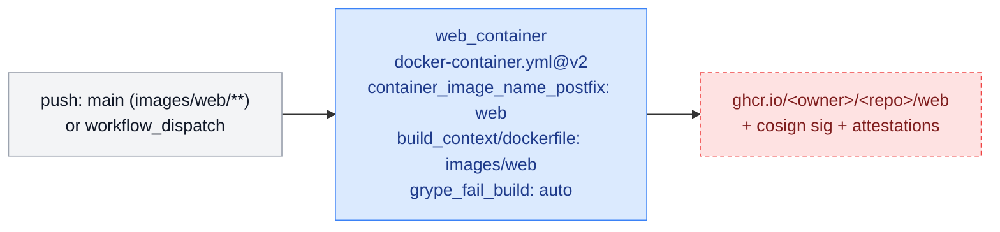

## Multi-arch + per-arch scan — `test-ghcr/multiarch-container.yml`

Same single-job shape, but `platforms: linux/amd64,linux/arm64` triggers a buildx
manifest-list build, and `scan_all_platforms: true` runs Grype against each arch
separately (distinct SARIF category per arch in Code Scanning).

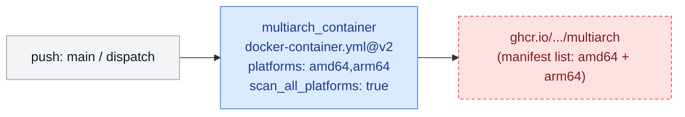

## PR container e2e → label-gated push — `test-ghcr/pr-test.yml`

The PR flow never pushes until e2e passes **and** the PR carries `deploy-feature`.
Images move between jobs as a `docker save | gzip` artifact so the **byte-identical**
content is what gets tested and later pushed. This is the one-job-per-image shape
(`build-and-scan-*`); the app repos have moved to the split pipeline, where each image is
built once and scan and e2e run in parallel on it.

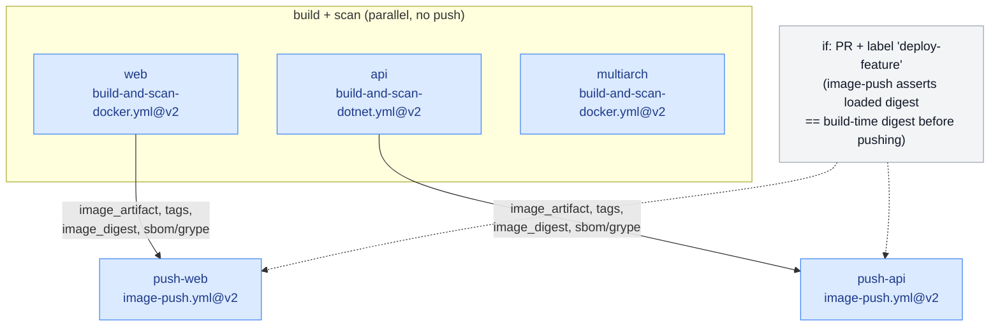

> In `test-ghcr` the e2e step is omitted (no app to drive). The apps' `pr-e2e.yml`
> (`build-image-*` → `scan-image` ‖ `playwright-e2e` → `image-push`) is drawn in
> [workflow-map.md](workflow-map.md).

## Consumer-side signing — `test-ghcr/web-container-consumer-signs.yml`

The canonical per-consumer-identity flow: build/scan **without** signing, push with
all sign flags off, then sign **in your own job** so the Fulcio cert SAN is your repo,
and finally verify it round-trips. Four jobs, each cross-checked against the previous.

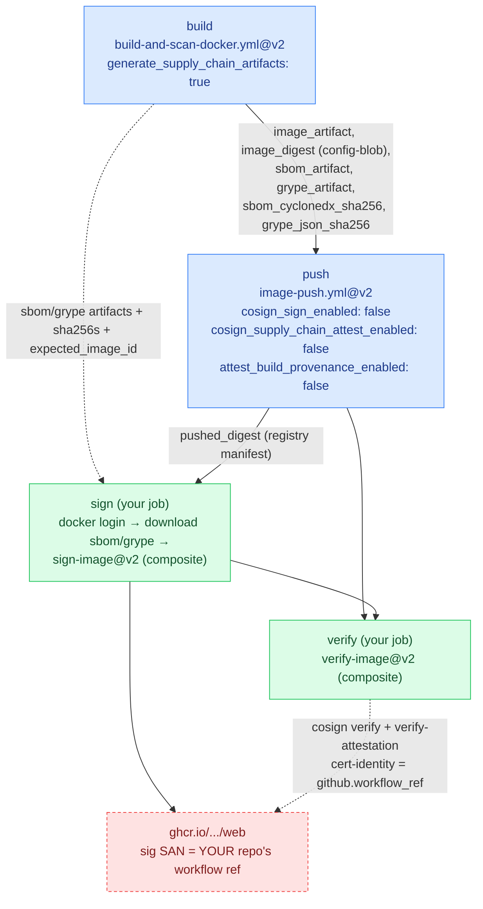

Integrity is pinned at every hop: the push job asserts the loaded image-ID matches
build, the sign job re-hashes the predicate files against `*_sha256` and checks the
CycloneDX `syft:image` binding against `expected_image_id`, cosign binds to the
registry `pushed_digest`, and verify confirms the signature exists under your identity.

> **v2 slimming:** `sign-image@v2` can download the predicates itself
> (`sbom_artifact_name` / `grype_artifact_name`) and auto-resolve the digest from the
> first `container_tags` entry — so the explicit `download-artifact` + path-resolve
> steps in the `sign` job become optional. The verbose form above still works and
> keeps the cross-job sha256 checks.

## PR build (lint / test) — `test-{npm,nuget,pypi}/*-pr.yml`

One reusable job per package, gated to the files that changed. `pr-build.yml`
auto-detects stacks; pass `node_enabled` / `dotnet_enabled` / `python_enabled` / `go_enabled`.

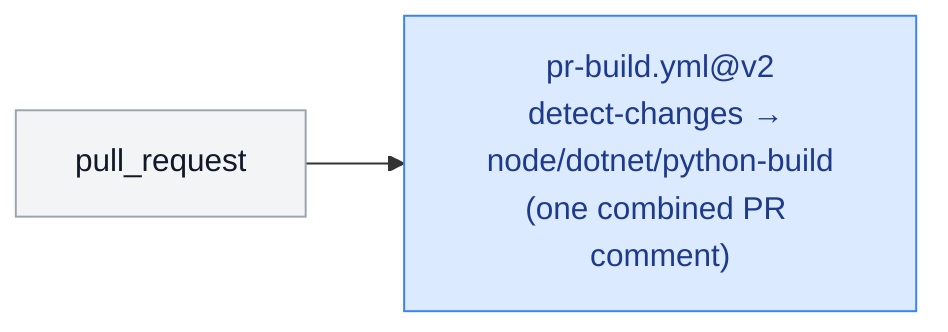

`clutterstock/ci.yml` is the multi-stack version of this (Node frontend +
`openapi-typescript` extra command, plus .NET backend, in one call).

## Package publish + fanout — `test-{npm,nuget}/*-publish.yml`

Consumers call the layer-2 `package-deploy.yml`, which computes one shared version and
fans out to the per-ecosystem deploy workflows. They do **not** call `npm-deploy.yml`
/ `nuget-deploy.yml` directly. `is_alpha` keys off PR vs `main`.

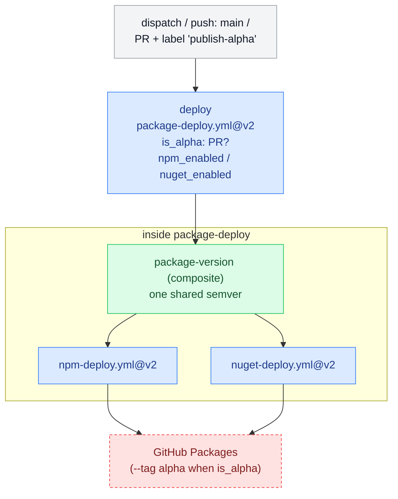

## PyPI trusted-publisher split — `test-pypi/*-publish.yml`

PyPI's OIDC trusted-publishing binds to the **calling** workflow's
`job_workflow_ref`, so the reusable side only **builds** the dist; the consumer runs
`pypa/gh-action-pypi-publish` in its **own** job (mirrors why `sign-image` is a
composite). The sdist+wheel flows across as a workflow artifact.

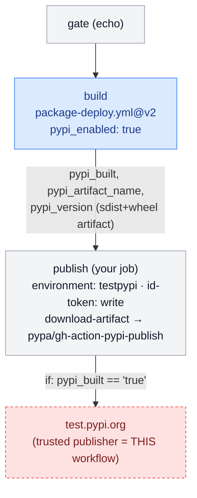

## Maintenance: registry pruning — `test-consumer/prune-*.yml`

Scheduled cleanup, thin wrappers around `prune-ghcr.yml` / `prune-npm.yml` /
`prune-nuget.yml`. Manual runs default to `dry_run: true`; the schedule forces a live
delete. Stable tags/versions and anything with a dist-tag are kept (fail-safe).

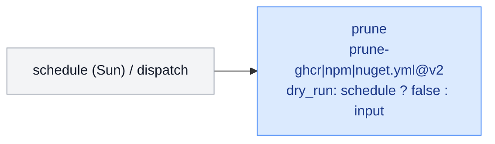

---

# Advanced — `clutterstock` (full-stack app)

A .NET API + migrator + React frontend, deployed by Flux from a signed manifests
artifact. The pull request and main pipeline (`pr-e2e.yml`), the nightly preview run and
the quality flow are drawn in [workflow-map.md](workflow-map.md). This section covers
the release and the rest of the repo's workflows. skylens, romslig, pbs-browser,
ddnsadmin and `test` follow the same shape with fewer images.

## Release — `tag-and-release.yml` → `container.yml` → `promote.yml`

`tag-and-release.yml` pushes the `v*` tag with the devops-bot GitHub App's token (job in
the `devops-bot` environment). Unlike a tag pushed with `GITHUB_TOKEN`, that push fires
`on: push: tags`, so `container.yml` starts by itself at the tag: it rebuilds the three
images, then renders `deploy/` with them pinned to tag@digest and pushes it as
`manifests:<version>`, signed with the `container.yml@refs/tags/v*` identity. The test
environment follows new releases through its OCIRepository's `ref.semver`. Production
moves only through `promote.yml`.

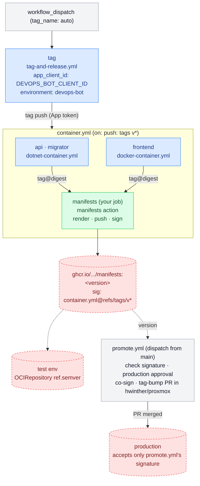

If the Grype gate stops a release on findings that can't be fixed yet, run
`container.yml` by hand at the tag with "Fail the build" off.

## The rest of the surface

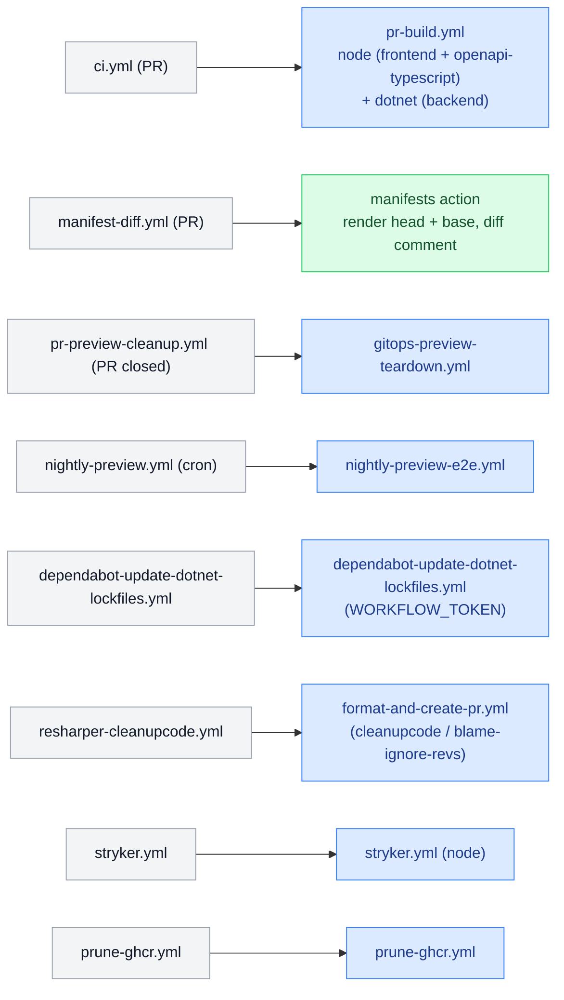

Repo-local, no reuse yet: `zap-scan.yml` (ZAP API scan against a mock-OIDC stack),
`api-docs-pages.yml` (GitHub Pages: API docs plus test and coverage reports),
`load-test.yml`, `nightly-e2e.yml` (being replaced by the nightly preview run) and
`contracts-nuget-publish.yml`. `manifest-diff`, `tag-and-release`, `dependabot-auto-merge`,
`label`, `type-label`, `stale`, `poutine` and `zizmor` are synced from `wshno/devops`
(header `# Synced from wshno/devops …`), so change them there.

---

# Edge case — `wsh-rtl-sdr` (multi-arch SDR feeders)

A fleet of independent `linux/amd64,linux/arm64` images (readsb, piaware, tar1090,
ais-catcher, …), each a static binary on distroless, plus a signed manifests artifact for
the edge-sdr cluster. There is no shared base image any more, so each image builds on
its own.

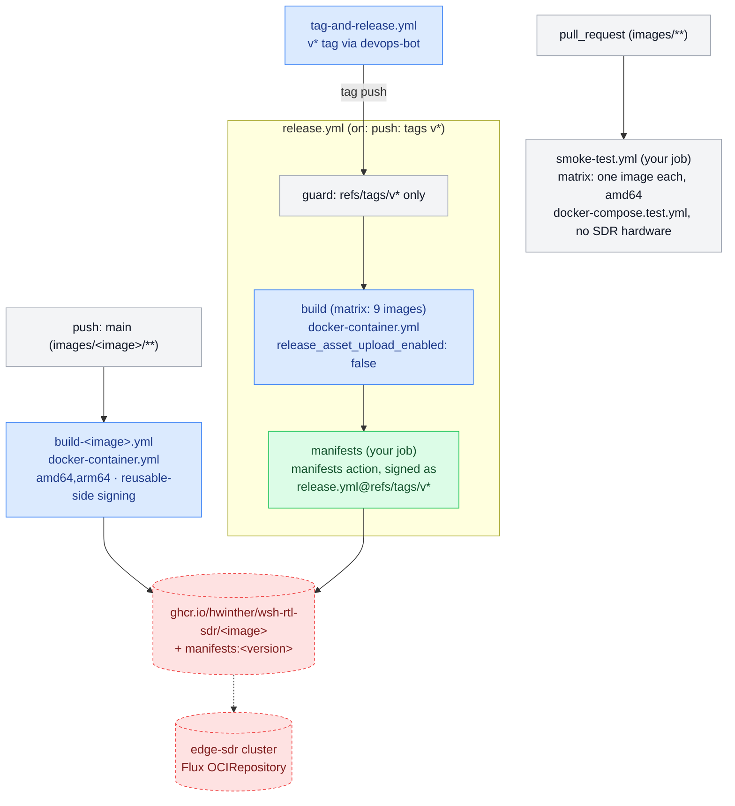

What makes it different from `clutterstock`:

- **Two publish paths.** A merge that touches `images/<image>/` publishes that one image
  (`build-<image>.yml`). A release rebuilds all of them in one matrix and ships the
  manifests that pin them.
- **PRs don't build through the library.** `smoke-test.yml` builds each image amd64-only
  and runs it in a no-hardware mode (readsb as a `--net-only` hub, ais-catcher reading
  `/dev/zero`). The multi-arch build and Grype scan happen on main.
- **Upstream bumps** come from `bump-sources.yml` and `bump-fr24feed.yml` (weekly PRs for
  pinned sources Dependabot can't track), which dispatch the smoke test for the image.

---

# Edge case — `proxmox` (infrastructure / GitOps repo)

Not an app: a homelab IaC + GitOps repo (Kubernetes/Flux manifests for two clusters,
a Python provisioning library, and two utility container images). It consumes the
library for the parts that *are* normal CI and hand-rolls the infrastructure-specific
validation. It is also the **target** of every app's preview deploys and production
promotions.

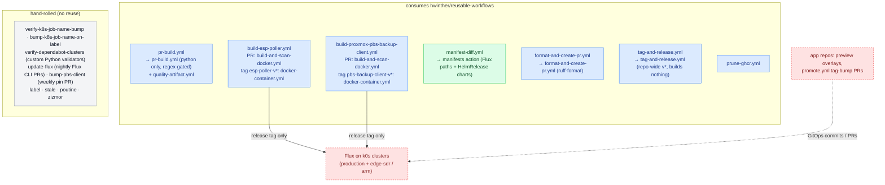

What makes it different from `clutterstock`:

- **PR build is Python-only**, gated by `python_changes_regex` to `src/`, `scripts/`,
  `pyproject.toml`: most PRs change YAML manifests, not Python.
- **Each image releases on its own tag prefix** (`esp-poller-v*`, `pbs-backup-client-v*`;
  GitVersion reads only that prefix). PRs build and scan without pushing, and merges to
  main publish nothing, so GHCR holds only release versions and Dependabot moves the
  CronJobs to them.
- **No deploy job.** "Deploy" is a Flux reconcile of committed manifests, so the heavy
  machinery is the hand-rolled validators (Job-name bump enforcement, Dependabot
  cluster-dir sync, nightly Flux updates), none of which this library provides.

---

# Cross-cutting patterns

- **Tag pushes that start the release.** A tag pushed with `GITHUB_TOKEN` doesn't fire
  `on: push: tags`. `tag-and-release.yml` therefore pushes with a GitHub App token
  (`app_client_id` + `app_private_key`, the devops-bot App), and the tag workflow
  (`container.yml`, `release.yml`) starts by itself. A hand-pushed tag works the same.
- **Release identity in the signature.** The manifests artifact is signed in the
  consumer's own job, so the cosign identity is `<workflow>.yml@refs/tags/v*`, which
  the cluster's OCIRepository verify pins. `promote.yml` adds a second signature that
  production requires.
- **Consumer-side signing for per-tenant identity.** Build with
  `cosign_sign_enabled: false` + `attest_build_provenance_enabled: false` (keep
  `cosign_supply_chain_attest_enabled: true` to still emit predicates), then call the
  `sign-image` **composite** in your own job. Because composites run inline, the
  Fulcio cert SAN is your repo — what per-consumer Kyverno/cosign policies need
  (`test-ghcr/web-container-consumer-signs.yml`).
- **Base-image chaining in one run.** A derived image built in the same run uses the
  base job's `image_digest` **output** as a `build_args` value (README base-image
  example). Across runs, pin `FROM …@sha256:…` in the derived Dockerfile and let
  Dependabot bump it.
- **Package fan-out + trusted publishing.** Consumers call `package-deploy.yml` (one
  shared version → per-ecosystem deploy). PyPI is special: the reusable side only
  builds the dist; the consumer runs `pypa/gh-action-pypi-publish` in its own job so
  the OIDC trusted-publisher binding stays pinned to the caller.
