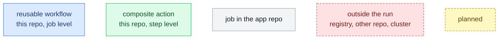
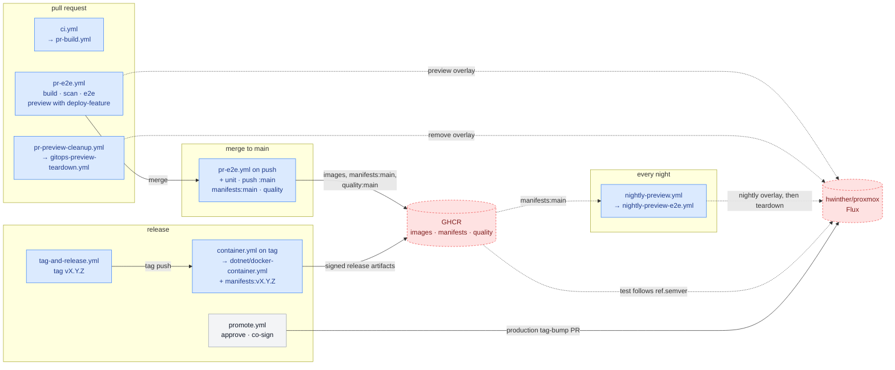
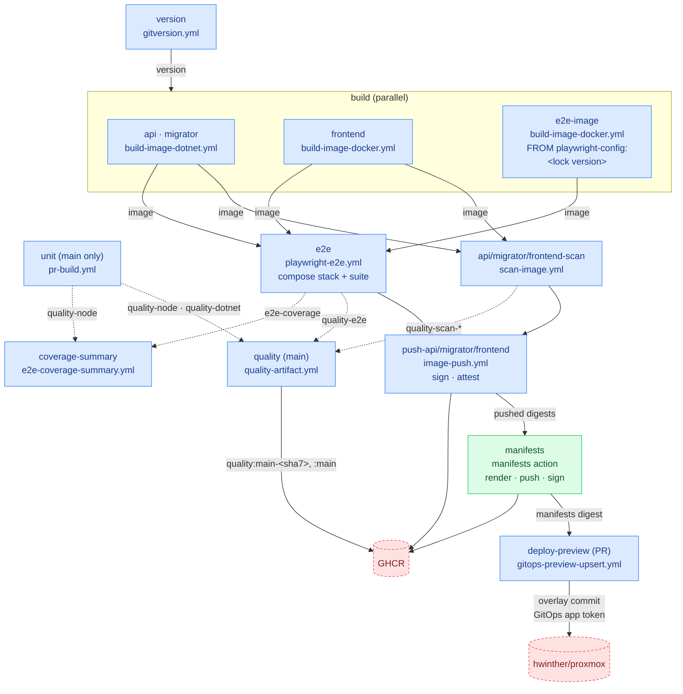
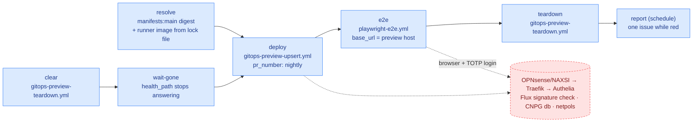
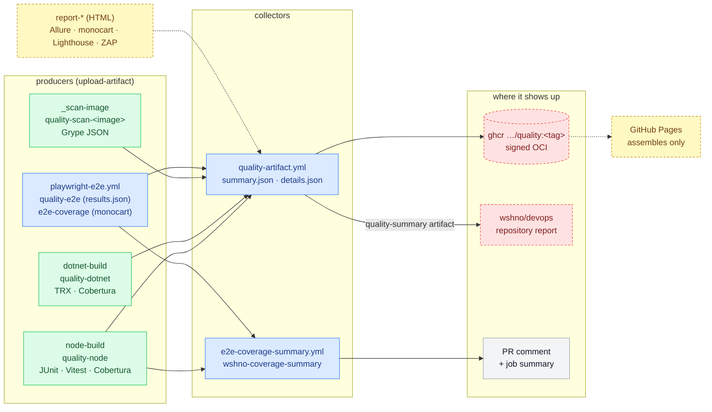
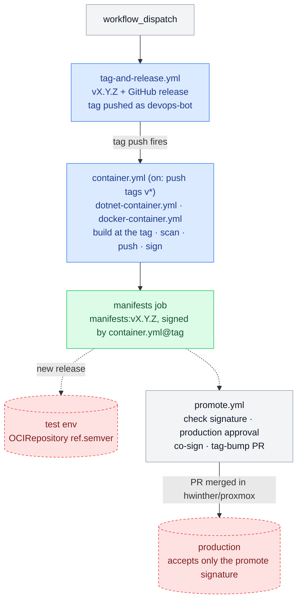

# Workflow map

How the reusable workflows link up across an app's lifecycle: pull request, merge to main, the
nightly run, release and production. Also covered: what each stage hands to the next (images, the
manifests artifact, test results). Drawn from ClutterStock's current workflows; skylens, romslig,
pbs-browser, ddnsadmin and test use the same shape with fewer images.
[consumer-topologies.md](consumer-topologies.md) has the smaller per-scenario examples.

Solid arrows are `needs:` or triggers, labelled with what travels along them. Dotted arrows are
data that is read later, by another run or another repo.

## The lifecycle

## `pr-e2e.yml`: pull requests and main

One workflow for both events. Each image is built once and handed on by reference: on same-repo
pull requests it goes to a staging tag (`pr-<N>-<sha7>`) as `repo@digest`, otherwise it is passed as
a workflow artifact. The scan, e2e and push all use those exact bytes. On pull requests the push,
manifests and preview steps run only with the `deploy-feature` label. On main they always run, and
`unit` and `quality` join in.

`manifest-diff.yml` (pull requests) renders the manifests with the same action and comments the
diff against main.

## `nightly-preview-e2e.yml`: the whole suite through the real chain

The app repo's caller supplies the schedule, `app_name`, `health_path` and the secrets. Everything
else comes from defaults derived from the app name: host, preview path and manifests repository.

## Results: from test jobs to the pages that show them

Every job that produces results uploads them under a fixed name. Collector workflows turn them
into something people read. The yellow nodes are the proposed next step: a single transport for
the HTML reports as well, so GitHub Pages only assembles and builds nothing itself.

## Release and production

Maintenance runs on its own schedules and doesn't link to the above. It covers `prune-ghcr.yml`
(staging tags of closed PRs, old versions), `prune-npm.yml`, `prune-nuget.yml`,
`dependabot-update-dotnet-lockfiles.yml`, `format-and-create-pr.yml` and `stryker.yml`.
